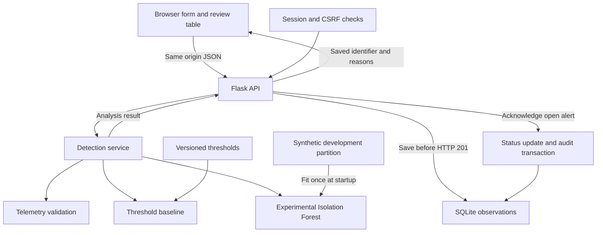

# Implemented System Architecture

The local Flask application separates presentation, request handling, detection,
and persistence. Analysis runs before an observation is stored. The current
SQLite database is not encrypted by the application.

The scaler and forest use 9,600 development observations. Both detectors are
evaluated on the same 2,400 held-out observations. Incoming API requests do not
retrain the model. Threshold breaches determine the stored alert status; the
forest result remains an experimental comparison.

The acknowledgement transaction updates an open observation and writes its audit
entry together. It records review for investigation, not equipment repair.
Authentication uses one configured prototype account. Organizational identity,
transport encryption, login throttling, and operational recovery remain staging
requirements. The application exposes no infrastructure-control endpoints.
